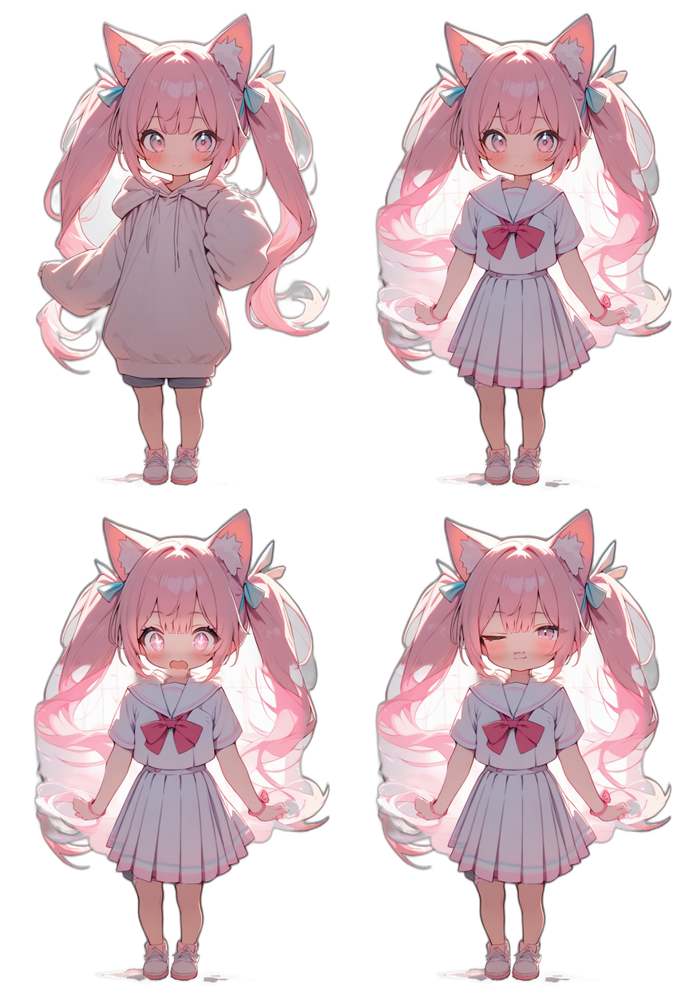
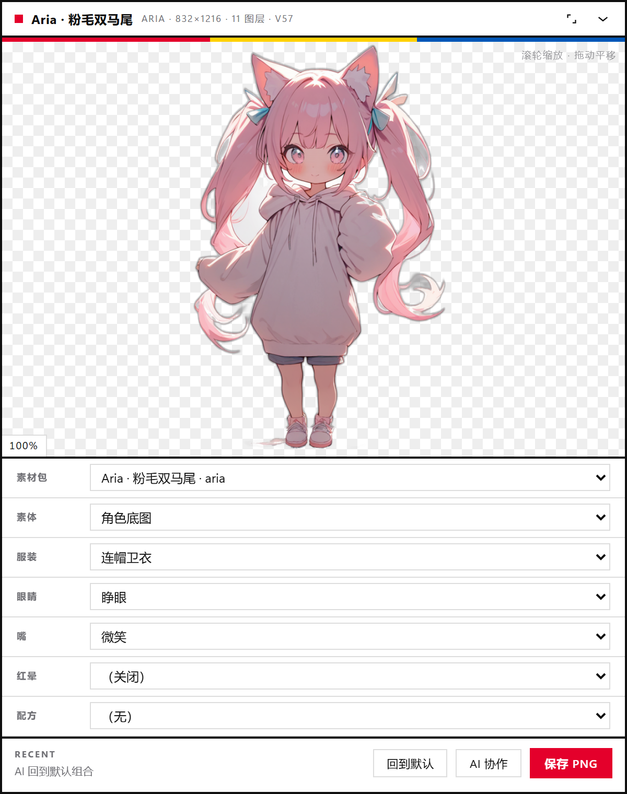

# 差分工坊 · Diff Forge

> 一个和 AI 一起改角色差分的通用工作台，跑在 [DeepSeek Harness](https://github.com/deepseek-ai/dsh) 上。
> 自带素材包格式、纯数据配方、可复制的 AI 协作简报。仓库里**没有任何游戏素材**。



`examples/aria` 的四种组合：卫衣 / 水手服 / 星星眼 + 张嘴 / 眨眼 + 坏笑。素材由本地 OpenVINO + Animagine XL 4.0 生成，表情与服装都是同一张底图上的局部重绘，做法见 [docs/ai-art.md](docs/ai-art.md)。


纯代码绘制的兜底示例 `examples/demo`：左为默认组合，中为卫衣 + 星星眼 + 滤镜配方，右为贴纸配方（黑描边 + 投影）。



面板：素材包切换、槽位下拉、配方、滚轮缩放预览、2400px 导出，以及给 AI 用的「协作简报」卡片。

---

## 为什么又做一个差分工具

大多数「立绘差分」工具都和某一款游戏、某一套加密格式、某一个目录结构绑死。换游戏就废，开源出去还容易把素材和工具一起传播。

Diff Forge 反过来：

- **只认数据和 PNG**。它不知道什么是 galgame、pbd、xp3，也不知道任何角色名。素材包是用户自己的目录。
- **槽位是显式的**。服装、表情、追加、红晕、眼镜……由 `pack.json` 声明哪些互斥、哪些可开关，不再靠猜。
- **配方是纯 JSON**。滤镜、描边、投影、翻转都是数据，不是可执行代码。AI 可以安全地写配方，插件负责校验。
- **AI 协作是一等公民**。面板里直接给你可复制的提示词，AI 写 `recipe.json` / `pack.json`，面板刷新就能看到结果——不用改插件代码。
- **缓存不折腾人**。合成图、缩略图、清单都有磁盘缓存，打开面板不会因为解码几十张 4K 图卡住 Host。

## 它能做什么

- 多素材包切换；每个包可以有自己的画布、槽位、默认组合。
- `single`（互斥选一）和 `toggle`（可开可关）两种槽位。
- 画布内任意 `x / y` 偏移、`z` 绘制顺序、每层透明度、初始可见性。
- 数据配方：`tint` / `brightness` / `contrast` / `saturate` / `grayscale` / `opacity` / `flip` / `shadow` / `border`。
- 面板内缩放 / 平移预览、导出 2400px PNG。
- 面板和 AI 工具共用同一份选择，AI 改完你立刻能看到。
- 一键复制「协作简报」：告诉 AI 当前包、槽位、文件该写去哪、有哪些硬性规则。

## 示例素材包

| 包 | 内容 | 说明 |
|---|---|---|
| `examples/aria` | 832×1216，11 层，5 槽位，3 配方 | 本地图像模型生成的粉毛双马尾，表情与服装都是同一张底图上的局部重绘，演示起来更像成品 |
| `examples/demo` | 720×1080，16 层，9 槽位，3 配方 | 纯代码绘制的兜底示例，零依赖、CC0，用来验证格式，不需要任何模型 |

两个包都会自动出现在面板的「素材包」下拉里。换掉它们也不难：删掉目录、放自己的 `pack.json` + PNG 即可。

## 快速开始

### 1. 安装到 DeepSeek Harness

把本仓库放到任意目录，然后在 Harness 里安装这个 bundle：

```text
plugin_manager  action=install_bundle  target=<本仓库的绝对路径>
```

或在 Harness 的插件管理界面里选择本目录安装。安装后会在 `shell.overlay` 里出现一个 `差分工坊` 面板（order 44）。

> 需要 Harness 版本支持 `dsh.bundle.patch` / `dsh.client` 的普通 bundle。仓库没有构建步骤，也不依赖任何 npm 包。

### 2. 放素材包

默认在 Host 进程的工作目录（通常是启动 `dsh web` 的目录）下找 `packs/`：

```text
<workspace>/
  packs/
    my-character/
      pack.json
      layers/
        body-a.png
        face-smile.png
        ...
```

如果 `packs/` 为空，插件会自动把仓库自带的 `examples/demo` 当成只读示例打开——装完就能看到预览。

也可以用插件配置覆盖路径：

```yaml
- insert:
    - id: diff-forge
      name: dsh-diff-forge
      config:
        packsDir: 'D:\art\my-packs'
        workDir: 'D:\art\diff-forge-work'
        includeExamples: true
```

### 3. 开始用

- 打开面板，选素材包、槽位、配方。
- 或直接让 AI 调工具：

```text
diff_forge action=layers
diff_forge action=set slot=eyes layer=eyes-closed
diff_forge action=recipe recipe=sunset
diff_forge action=snapshot width=1200
```

## 素材包格式（速查）

完整字段、限制和常见错误见 [docs/pack-format.md](docs/pack-format.md)。

```json
{
  "schema": "diff-forge/pack@1",
  "id": "my-character",
  "title": "我的角色",
  "canvas": { "width": 1200, "height": 1800 },
  "slots": [
    { "key": "base", "label": "素体", "mode": "single", "default": "head" },
    { "key": "costume", "label": "服装", "mode": "single" },
    { "key": "face", "label": "表情", "mode": "single" },
    { "key": "blush", "label": "红晕", "mode": "toggle" }
  ],
  "layers": [
    { "id": "head", "name": "头", "src": "layers/head.png", "slot": "base", "z": 20 },
    { "id": "body-a", "name": "便服", "src": "layers/body-a.png", "slot": "costume", "z": 10 },
    { "id": "face-smile", "name": "微笑", "src": "layers/face-smile.png", "slot": "face", "z": 30 },
    { "id": "blush", "name": "红晕", "src": "layers/blush.png", "slot": "blush", "z": 32 }
  ]
}
```

要点：

- 图层按 `z` 从小到大画（小的在后），同 `z` 按声明顺序。
- `single` 槽位永远恰好有一张；`toggle` 槽位可以没有。
- PNG 必须是 **8 位 RGBA、非交错**（普通导出即可）。
- `src` 只能是包内相对路径；`..`、绝对路径、URL 都会被拒绝。

## 配方格式（速查）

完整 op 列表见 [docs/recipe-format.md](docs/recipe-format.md)。

```json
{
  "schema": "diff-forge/recipe@1",
  "id": "sunset",
  "label": "黄昏",
  "ops": [
    { "op": "tint", "color": "#ff8a3d", "amount": 0.18 },
    { "op": "brightness", "amount": 0.04 },
    { "op": "saturate", "amount": 1.12 },
    { "op": "shadow", "dx": 0, "dy": 10, "alpha": 0.18 }
  ]
}
```

自建配方放在 `<workDir>/recipes/*.json`，面板和工具会热加载；同 id 会覆盖包内自带的配方。

## 和 AI 一起工作

这是本项目最想做的事：**让 AI 写数据，而不是写插件。**

```text
你：想要一套黄昏逆光的配色
  ↓ 点面板里的「AI 协作 → 复制」
AI：读简报 → 写 work/recipes/sunset.json
  ↓
插件：校验 schema / 数值 / 路径 → 热加载
  ↓
面板：选择配方，立刻预览
```

面板里有四张现成卡片：新配色、做素材包、诊断重影、扩展插件。点「复制」就能发给任意 AI（包括 Harness 里的 agent）。点「复制完整简报」会带上当前包、槽位、选择和工作目录。

详细流程、安全边界和示例对话见 [docs/ai-collaboration.md](docs/ai-collaboration.md)。

### 为什么不让 AI 改插件代码？

- **安全**：插件不执行 AI 生成的代码，只读取经过白名单校验的 JSON。
- **可移植**：配方和素材包换一台机器、换一个 AI 仍然有效。
- **可审查**：一个 JSON diff 比一段动态代码容易 review 得多。
- **法律上更干净**：仓库不分发别人的素材；用户自己的素材留在用户自己的目录里。

当然，代码本身是 MIT，欢迎 fork 和改——只是**扩展效果不需要改代码**。

## 目录

```text
diff-forge/
  index.js              Host：路由 + diff_forge 工具
  client.js             Client：浮窗面板
  lib/
    pack.mjs            素材包发现 / 校验 / 默认选择
    recipe.mjs          配方校验 + 像素后处理
    render.mjs          合成 + 磁盘缓存
    png.mjs             零依赖 PNG 编解码
    state.mjs           共享选择状态
    guide.mjs           AI 协作简报生成
  examples/
    aria/               图像模型生成的示例角色（832×1216，11 层 / 5 槽位）
    demo/               代码绘制的兜底示例（720×1080，16 层 / 9 槽位，CC0）
  scripts/              生成示例 / 校验 / 渲染预览
  tests/                node:test 测试（pack / recipe / route / client）
  docs/                 格式文档、AI 协作文档、法务说明、截图
  locale/               面板文案（zh / en）
  icon.svg              面板图标
```

## 开发

需要 Node.js ≥ 20（只用到标准库）。

```bash
npm test              # 15 个测试：pack / recipe / 路由 / 客户端注册
npm run validate      # 校验 examples/ 下所有素材包
npm run demo          # 重新生成示例素材（会覆盖 examples/demo）
npm run previews      # 重新渲染 docs/ 里的预览图
```

测试不启动浏览器：`tests/route.test.mjs` 用假的 webServer 直接跑路由，覆盖 state / set / render / thumb / export / prompt。

`docs/ai-art.md` 记录了 `examples/aria` 是怎么在本机用 OpenVINO + Animagine XL 4.0 生成的；那份脚本不在仓库里，你可以用任何模型替换它。

## 边界、安全与法律

- **仓库里没有游戏素材。** `examples/aria` 由本地图像模型生成，`examples/demo` 由代码绘制，都按 CC0 发布。
- **用户自带素材（BYO assets）。** 使用前请确认你有权使用这些图片；不要再分发你无权分发的素材。
- **不做解密、不解析商业游戏格式。** 插件只读普通 PNG 和 JSON。
- **路径被限制在素材包目录内**，配方 op 走白名单，最多 32 个；不会执行任意代码。
- 代码 MIT；示例素材 CC0。详见 [docs/legal.md](docs/legal.md)。

## 常见问题

**装完没有面板？**
确认 `plugin_manager action=list_plugins` 里有 `dsh-diff-forge` 并已启用，然后刷新页面。面板挂在 `shell.overlay`，z-index 很高，正常不会被聊天区盖住。

**素材包下拉里只有内置示例？**
你的 `packs/` 目录是空的或路径不对。用配置项 `packsDir` 指向放 `pack.json` 的目录，或者把包放进工作目录的 `packs/<slug>/`。

**包出现了，但旁边有黄色警告？**
`pack.json` 校验没过。跑 `node scripts/validate-pack.mjs <包目录>`，报错会点名具体字段——路径越界、PNG 尺寸不一致、槽位默认值引用不存在的图层都会在这一步暴露。

**预览一片空白或出现黑块？**
PNG 必须是 8 位 RGBA、非交错；尺寸要等于画布尺寸（或配合 `x / y` 偏移使用）。带调色板或 16 位的图会被拒绝。

**改了 recipe 没反应？**
面板每 1.5 秒轮询一次；确认改的是 `<workDir>/recipes/*.json`，并且 JSON 合法、op 在白名单里。缓存按文件大小 + mtime 失效，保存后下一次轮询就会重画。

**能导出透明底吗？**
能，导出就是合成的 PNG（带 alpha）。想要白底/黑底可以自己加合成规则，或者用导出图再处理。

**滚轮缩放 / 拖动预览没反应？**
先确认鼠标停在预览图上（不是下面的下拉框），且只能在放大后拖动；双击预览图或点「复位」回到 100%。

## 贡献

欢迎 issue / PR。开工前先读 [CONTRIBUTING.md](CONTRIBUTING.md)；安全相关问题走 [SECURITY.md](SECURITY.md)。

底线只有一条：**示例和测试里不放任何游戏素材、角色名或公司名**。

## Roadmap

- [ ] 多配方叠加与排序
- [ ] 图层级配方（只给某个槽位加效果）
- [ ] 导出 GIF / 逐帧
- [ ] 按标签筛选图层
- [ ] 面板内直接编辑 pack.json（带校验）

## English

**Diff Forge** is a generic, game-agnostic layered-character variation studio for DeepSeek Harness. Bring your own PNG pack (`packs/<slug>/pack.json`), define exclusive slots, stack layers, apply data-only recipes, and export PNGs. The panel and the agent tool share one selection.

Two example packs ship with the repo: `examples/aria` (832×1216, 11 layers, generated on-device with OpenVINO + Animagine XL 4.0) and `examples/demo` (720×1080, 16 layers, drawn by code as a dependency-free fallback).

The AI collaboration loop: copy a ready-made brief from the panel → the AI writes a `recipe.json` or `pack.json` → the plugin validates and hot-reloads it. No AI-generated code is executed, no game assets are bundled, and all paths stay inside the pack directory.

```bash
npm test
node scripts/validate-pack.mjs examples
```

MIT for code, CC0 for the bundled example art. See [docs/pack-format.md](docs/pack-format.md), [docs/recipe-format.md](docs/recipe-format.md), [docs/ai-collaboration.md](docs/ai-collaboration.md), and [docs/ai-art.md](docs/ai-art.md).

## License

MIT © Diff Forge contributors. Example artwork (`examples/aria`, `examples/demo`) CC0-1.0.
